<div align="center">
  
</div>

<div align="center">
  
</div>

Computer Science & Engineering at UC Irvine (expected June 2027).

## Featured

| Project | What it is |
| :-- | :-- |
| [**SVMCheck**](https://github.com/BlueSpiderLily/SVMCheck) | An AMD SVM hypervisor built as a Windows kernel driver. It runs an isolated synthetic guest, handles nested page faults and MSR access in software, and exposes a small administrator-only control interface. |

## Write-ups and talks

- **Gaming the System: Kernel Exploits and the Flaws of Anti-Cheats**, 15th Annual Community College Honors Research Symposium, UC Berkeley (April 26, 2025).
- Reverse-engineering walkthroughs on [GuidedHacking](https://guidedhacking.com/members/onlyformutjay.235958/): a legacy anti-cheat (PunkBuster) and advanced multi-layer anti-tamper crackmes.

## Toolbox

```text
languages    C++ · x86-64 assembly · C · C# · Python · Verilog
systems      AMD SVM · Windows kernel · DMA · RISC-V
tools        IDA Pro · Ghidra · WinDbg · x64dbg · ReClass · Unicorn Engine
hardware     FPGA (Vivado) · STM32CubeIDE · Raspberry Pi 5
environment  Unix · Ubuntu / Kali Linux · Git
```
