  

  

  

## Featured

| Project | What it is |
| :-- | :-- |
| [**SVMCheck**](https://github.com/BlueSpiderLily/SVMCheck-showcase) | An AMD SVM hypervisor built as a Windows kernel driver. It runs an isolated synthetic guest, handles nested page faults and MSR access in software, and exposes a small administrator-only control interface. The showcase repo has the architecture, design notes and ABI docs. |
